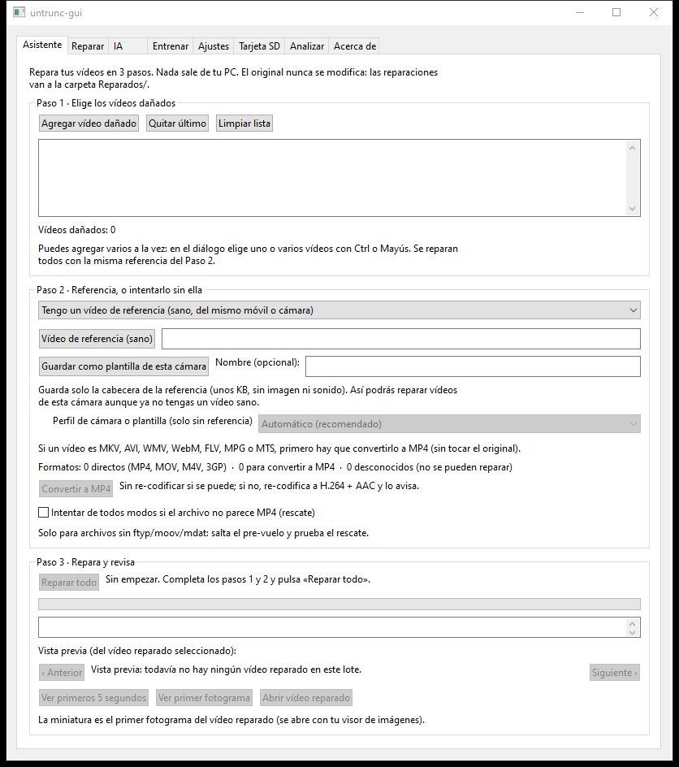

# untrunc-mejorado

**Recupera vídeos MP4 / MOV dañados o cortados** — los que no se abren porque
la cámara o el móvil se apagaron grabando, la tarjeta se llenó o se sacó a
mitad de la grabación. Gratis, de código abierto y **sin que tus vídeos salgan
de tu PC**.

*English summary [below](#english).*

## Descarga (Windows 10/11, 64 bits)

1. Baja el ZIP de la última versión en **[Releases](https://github.com/agarciaaa/untrunc-mejorado/releases/latest)**.
2. Descomprímelo entero en cualquier carpeta (o en un USB).
3. Doble clic en **`untrunc-gui.exe`**.

No hay que instalar nada: el ZIP ya trae FFmpeg y Python. Como el programa no
está firmado, Windows puede mostrar un aviso azul de SmartScreen: pulsa
*Más información* → *Ejecutar de todas formas* (explicado en
`LEEME-Primeros-pasos.txt`, dentro del ZIP).

## Cómo se usa

En la pestaña **Asistente**:

1. **Elige el vídeo dañado** (o varios).
2. **Elige un vídeo sano de referencia**: grabado con el mismo móvil o cámara
   y la misma configuración (resolución, fps). Si no tienes ninguno, elige
   *No tengo referencia: intentar sin ella*.
3. **Pulsa «Reparar todo».** El resultado va a una carpeta `Reparados/` junto
   al vídeo. **El original nunca se modifica.**

Al terminar, el programa comprueba el vídeo reparado fotograma a fotograma y
te dice si se ve bien de principio a fin o en qué segundos hay errores.

## Qué hace

| | |
|---|---|
| **Repara con referencia** | Toma la estructura de un vídeo sano de la misma cámara y la aplica al dañado. Es el método más fiable. |
| **Repara sin referencia** | Usa una *plantilla* guardada de tu cámara (pesa unos KB) o genera una referencia sintética con los parámetros que detecta en el propio vídeo. |
| **Rescata desde la tarjeta SD** | Busca los vídeos en una tarjeta, pendrive o imagen de disco **solo en lectura**, copia los completos y junta y repara los cortados o partidos en trozos. |
| **Diagnóstico en español** | Antes de reparar, avisa si la referencia no sirve, si los archivos están intercambiados o si falta algo, y explica qué hacer. |
| **Lote** | Repara muchos vídeos de una vez con la misma referencia. |
| **Aprende de cada reparación** | Guarda solo números (nunca vídeo) y mejora su motor con las cámaras que vas reparando. |
| **Otros formatos** | MKV, AVI, WMV, WebM, FLV, MPG y MTS: los convierte a MP4 y después los repara. |

Interfaz y mensajes en español. También hay línea de comandos (`untrunc.exe`):
ver la [guía completa](README-ESPANOL.md).

## Privacidad

La reparación, la detección y el aprendizaje funcionan **sin internet**. Tus
vídeos no se suben a ningún sitio ni se copian a las carpetas del programa.
Las conexiones a IA opcionales (LM Studio con Qwen en tu propia PC, o una API
externa) vienen apagadas y, si las activas, solo reciben un diagnóstico en
texto de menos de 50 KB, nunca el vídeo.

## Lo que no puede hacer

Ningún programa puede recuperar lo que no está en el archivo: fotogramas
borrados o sobrescritos, archivos de 0 bytes, o datos que la cámara nunca llegó
a escribir. Tampoco «mejora la calidad»: el vídeo reparado no se re-codifica.

## Más información

- [Guía completa en español](README-ESPANOL.md): línea de comandos, plantillas,
  tarjeta SD, entrenamiento, requisitos y detalles técnicos.
- [Compilar desde el código](README-ESPANOL.md#compilar-desde-el-código)
  (Windows con MSYS2 y Linux).
- [Cómo contribuir](CONTRIBUTING.md) y [cómo informar de un fallo de
  seguridad](SECURITY.md).

## Apoya el proyecto

untrunc-mejorado es gratis y lo seguirá siendo. Si te recuperó un vídeo
importante y quieres ayudar a que siga mejorando:

- **[Ko-fi](https://ko-fi.com/agarcia322)**: sin necesidad de cuenta de
  GitHub.
- **[GitHub Sponsors](https://github.com/sponsors/agarciaaa)**: si tienes
  cuenta de GitHub (también con el botón **❤ Sponsor** de arriba).

También ayuda mucho contar qué cámara reparaste o compartir una plantilla
(ver [Cómo contribuir](CONTRIBUTING.md)).

## Créditos y licencia

Este proyecto es un fork de **[anthwlock/untrunc](https://github.com/anthwlock/untrunc)**,
que a su vez parte del Untrunc original de **[Federico Ponchio](https://github.com/ponchio/untrunc)**
(CNR ISTI). Todo el mérito del motor de reparación es suyo y de sus
colaboradores; su README original está en
[docs/README-untrunc-original.md](docs/README-untrunc-original.md).

Licencia **GNU GPL-2.0** (ver [COPYING](COPYING)). El ZIP de Windows incluye
FFmpeg 7.1 (compilado como GPL-2.0), libui (MIT) y Python con numpy (licencias PSF y BSD),
entre otros: sus licencias y dónde está su código fuente van en la carpeta
`LICENCIAS\` del ZIP.

---

## English

**untrunc-mejorado** repairs damaged or truncated MP4/MOV videos (recordings
whose final index was never written because the camera stopped, the card was
full or was removed). It is a fork of
[anthwlock/untrunc](https://github.com/anthwlock/untrunc) with a Spanish GUI
and these additions:

- **No-reference repair** using saved per-camera header templates or a
  synthetic reference built from parameters detected in the video itself.
- **SD-card rescue**: scans a card, USB stick or disk image read-only, copies
  complete videos and stitches and repairs truncated or fragmented ones.
- **Pre-repair diagnosis**, batch repair, and a frame-by-frame check of the
  result that reports exactly which seconds have errors.
- **Local learning**: improves its resync model from each repair, storing only
  numbers, never video.
- **Portable Windows ZIP** with FFmpeg and Python bundled: unzip and run
  `untrunc-gui.exe`, nothing to install.

Everything runs offline; videos never leave your computer. Download the
Windows build from [Releases](https://github.com/agarciaaa/untrunc-mejorado/releases/latest).
To build from source see
[Compilar desde el código](README-ESPANOL.md#compilar-desde-el-código)
(`make` on Linux with the system FFmpeg; MSYS2 on Windows). Bug reports and
pull requests are welcome in English or Spanish — see
[CONTRIBUTING.md](CONTRIBUTING.md). License: GPL-2.0.

If it saved a video for you, you can support the project on
[Ko-fi](https://ko-fi.com/agarcia322) (no GitHub account needed) or on
[GitHub Sponsors](https://github.com/sponsors/agarciaaa).
